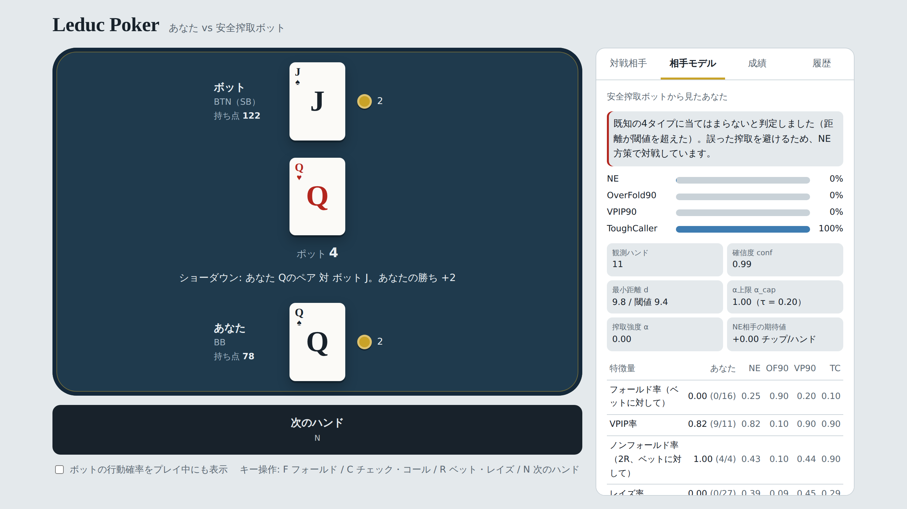

# Leduc Poker — ボット対戦

研究で作成した Leduc Poker のボットと、人間がブラウザ上で対戦できる Web アプリです。
HTML ファイル1つで動き、サーバーやビルドは不要です。



## 主な機能

- **ボットとの対戦**：カード表示、ポット・持ち点の表示、キーボード操作（F / C / R / N）に対応しています。
- **内蔵 CFR+ ボット**：ページを開くとブラウザ内で CFR+ を 2000 反復学習し、均衡近傍戦略で対戦します。
- **安全搾取ボット**：プレイヤーの行動から相手タイプを推定し、安全制約の下で搾取します（下記「安全搾取ボット」参照）。
- **自作ボットの登録**：戦略を JSON または `.pkl` で最大 8 体まで登録できます。
- **成績の記録**：相手ごとにハンド数、収支、1ハンド平均と 95% 信頼区間、マッチの勝敗を記録し、全ボットを比較表で並べます。
- **ハンド履歴**：ボットの手札と、各判断での情報集合キー・行動確率を公開します。

## ルール

ヘッズアップのリミット制 Leduc Hold'em です。

- デッキは J・Q・K が各 2 枚の計 6 枚で、各プレイヤーに 1 枚配られ、2 ラウンド目の前に公開カードが 1 枚開きます。
- ブラインドは BTN（SB）が 1、BB が 2 で、BTN はハンドごとに交代します。
- ベット・レイズ額は 1 ラウンド目が 2、2 ラウンド目が 4 で、各ラウンドのレイズは最大 2 回です（ブラインドは数えません）。
- 1 ラウンド目は BTN、2 ラウンド目は BB から行動します。
- 公開カードとペアなら勝ち、そうでなければ高いカードが勝ち、同ランクは引き分けです。
- 持ち点は各 100 で、ハンドをまたいで持ち越します。どちらかが 0 になるとマッチ終了です。

OpenSpiel の `leduc_poker`（アンテ方式）とは手番や最初の選択肢が異なります。

## 使い方

### ローカルで開く

`index.html` をブラウザで開くだけで動きます。

### GitHub Pages で公開する

1. このリポジトリを GitHub に push します。
2. リポジトリの **Settings → Pages** で、Source に `main` ブランチの `/ (root)` を選びます。
3. 数分後、`https://<ユーザー名>.github.io/<リポジトリ名>/` で公開されます。

## 自作ボットの登録

「対戦相手」タブの「ボットを追加」から、JSON または `.pkl` を読み込みます。

### JSON 形式

キーが情報集合、値が `[fold, call, raise]` の確率です。

```json
{
  "K:":     [0.0, 0.2, 0.8],
  "Q:c":    [0.0, 0.7, 0.3],
  "JK:rc/": {"f": 0, "c": 0.6, "r": 0.4}
}
```

キーは `<自分のカード><公開カード>:<1R履歴>/<2R履歴>` です。履歴は `c`（チェック/コール）と `r`（ベット/レイズ）で、公開カードと `/` は 2 ラウンド目のみ付きます。履歴の長さで手番が決まります。全 288 情報集合のうち未定義のものでは、一様ランダムに行動します。

### pkl 形式

`.pkl` は中身を自動で解析し、「情報集合 → 確率」の表を探して JSON 形式に変換します。

- 対応する構造：dict、defaultdict、numpy 配列、自作クラスのノード（`strategy_sum` などの属性）、OpenSpiel の `TabularPolicy`
- 対応するキー：上記の形式、OpenSpiel の情報状態文字列、`"KQrcr"` や `(2, 1, "rc")` のようなカード＋行動列

pkl はブラウザ内でデータとして読むだけで、中のコードは実行しません。PyTorch のモデルなど、表になっていないボットは読み込めません。

## 安全搾取ボット

内間・石川「Leduc Poker における相手タイプ推定に基づく安全な搾取戦略の評価」（情報処理学会 GI59）の手法を、このアプリのルールに合わせて実装しています。

- 相手タイプは NE、OverFold90、VPIP90、ToughCaller の 4 つです。
- フォールド率、VPIP 率、ノンフォールド率、レイズ率の 4 特徴量をタイプごとに Beta-Binomial でモデル化し、ベイズ則で事後確率 `w` を求めます。
- 方策は `π = (1−α)π_NE + α Σ w_t π_t^BR`、`α = min(conf, α_cap)` です。
- `α_cap` は NE 相手の期待値低下が `τ` 以内に収まる最大の α で、ゲーム木の厳密評価で求めます。
- 未知タイプの棄却（距離ベース／エントロピーベース）では、既知 4 タイプを同じ観測数でシミュレーションし、95% を受理する閾値を毎ハンド設定します。

「相手モデル」タブで、推定結果と各指標をリアルタイムに確認できます。

## データの保存

登録したボット、成績、安全搾取ボットの観測データは、ブラウザの localStorage に保存されます。外部に送信されることはありません。ブラウザやドメインが変わるとデータは引き継がれません。

## ファイル構成

```
.
├── index.html          アプリ本体（HTML / CSS / JavaScript を1ファイルに格納）
├── README.md
└── docs/
    └── screenshot.png
```

## 著者

内間 壮一郎（立教大学大学院 人工知能科学研究科）
